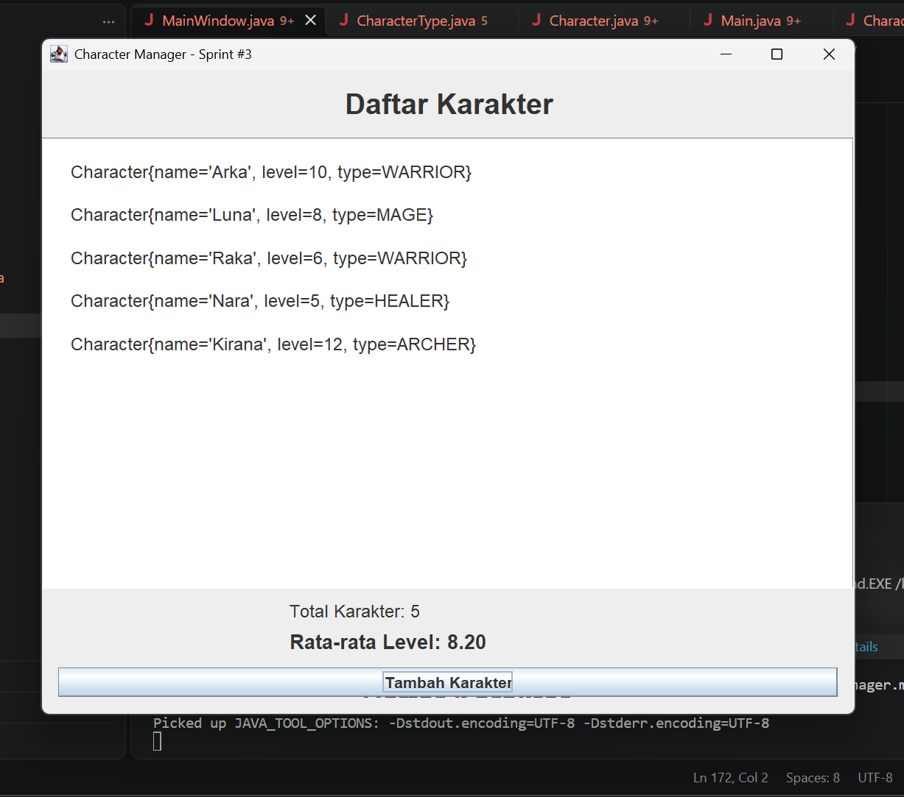

# CharacterManager

## TP5 — Character Manager Sprint #2

### 1. Deskripsi
Project ini mengimplementasikan pengelolaan karakter menggunakan Java.
Fitur meliputi penambahan, pencarian, penghapusan, analitik level,
pencarian berdasarkan tipe, dan pengujian reference.

### 2. Fitur Bagian A
- equals() membandingkan nama karakter.
- addCharacter() menolak nama duplikat.
- findByName() mencari karakter.
- removeCharacter() menghapus karakter.
- getTotalCharacters() menghitung data yang tersimpan.
- getAllCharacters() mengembalikan salinan ArrayList.

### 3. Fitur Bagian B
- getAverageLevel() menghitung rata-rata level.
- Mengembalikan 0.0 ketika daftar kosong.
- findByType() mencari semua karakter berdasarkan tipe.

### 4. Fitur Tambahan Bagian C
Fitur tambahan: countByType(CharacterType type).

Method ini menghitung jumlah karakter berdasarkan tipe yang dipilih.
Fitur ini membantu pengguna mengetahui jumlah karakter WARRIOR,
MAGE, atau ARCHER tanpa harus menghitungnya secara manual.

Method tidak mengembalikan ArrayList internal sehingga struktur
data karakter tetap terlindungi.

### 5. Pengujian

#### Output


#### Eksperimen Reference
Masukkan screenshot eksperimen a = b dan getAllCharacters() di sini.

### 6. Analisis Google Docs
Link Google Docs: [https://docs.google.com/document/d/1StKogg62ViMKlBcTAEO96wD5XwZnzVyQ7Y10SFtcomU/edit?usp=sharing]

### 7. Teknologi
- Java
- VS Code
- Git dan GitHub


## TP8 — MainWindow, Event-Driven Programming, dan MVC

### Implementasi MainWindow

Program Character Manager dikembangkan menggunakan Java Swing.
Kelas MainWindow berada di package view dan extends JFrame.
Data karakter ditampilkan secara dinamis menggunakan perulangan
for berdasarkan data dari CharacterManager.

### Screenshot Program

**Sebelum perubahan data — 3 karakter**

()

**Sesudah perubahan data — 5 karakter**

()

Statistik rata-rata level berubah dari 8,33 menjadi 8,60
setelah dua karakter baru ditambahkan.

### Aliran Data dan Prinsip MVC

Main.java membuat objek CharacterManager dan memasukkan data
karakter ke dalamnya. CharacterManager bertugas menyimpan dan
mengelola data karakter, termasuk menghitung rata-rata level.
MainWindow mengambil data melalui CharacterManager dan menampilkan
daftar karakter serta statistik dalam komponen JLabel.
Aliran ini menerapkan prinsip MVC karena model mengelola data,
view bertanggung jawab atas tampilan, dan pemisahan keduanya
membuat program lebih mudah dirawat.

### Karakter Baru

1. Luna — HEALER, level 6. Dipilih untuk melengkapi variasi
   peran karakter dengan kemampuan pendukung.
2. Ragnar — WARRIOR, level 12. Dipilih untuk menambah variasi
   level dan membandingkan karakter dengan level lebih tinggi.

### Dokumentasi Analisis TP8

[Google Docs — Analisis GUI dan MVC](https://docs.google.com/document/d/1f-ECuWz--cHbNq6ZMyi9WH1w2WBP8pyJzqAXe657lE8/edit?usp=sharing)


# Character Manager — TP10 (Java Swing & MVC)

Aplikasi desktop untuk menampilkan karakter RPG menggunakan Java Swing. Proyek ini menerapkan konsep PBO, pola MVC, serta tampilan kartu karakter yang dinamis.

## Fitur Utama

- Menampilkan data karakter dalam bentuk kartu.
- Menggunakan empat role: WARRIOR, MAGE, ARCHER, dan HEALER.
- Warna kartu berbeda sesuai role karakter.
- Karakter dengan level minimal 5 mendapat warna emas dan tulisan tebal.
- Menampilkan rata-rata level karakter.
- Mengatur warna, font, dan border melalui `AppTheme.java`.

## Arsitektur MVC

- **Model:** `Character.java` dan `CharacterType.java` untuk mengelola data karakter.
- **View:** `MainWindow.java` untuk menampilkan GUI dan `AppTheme.java` untuk mengatur tema.
- **Runner:** `Main.java` untuk membuat data dan menjalankan aplikasi.

## Struktur Proyek

```text
Character Manager/
└── src/
    └── com/unpri/charactermanager/
        ├── Main.java
        ├── model/
        │   ├── Character.java
        │   └── CharacterType.java
        └── view/
            ├── AppTheme.java
            └── MainWindow.java
```

## Penjelasan Kelas

- `Character.java`: Menyimpan data karakter.
- `CharacterType.java`: Menentukan role karakter.
- `AppTheme.java`: Mengatur warna, font, dan border.
- `MainWindow.java`: Menampilkan kartu karakter menggunakan Java Swing.
- `Main.java`: Menjalankan aplikasi.

## Hasil Pengujian

Program berhasil menampilkan kartu karakter secara dinamis. Warna kartu menyesuaikan role, karakter dengan level minimal 5 mendapatkan highlight emas, dan rata-rata level ditampilkan pada jendela aplikasi.

## Cara Menjalankan

**Melalui VS Code:**
1. Buka folder proyek.
2. Buka `Main.java`.
3. Klik **Run** atau tekan F5.

**Melalui CMD:**

```cmd
if not exist out mkdir out
dir /s /b src\*.java > sources.txt
javac -encoding UTF-8 -d out @sources.txt
java -cp out com.unpri.charactermanager.Main
```

## Teknologi

- Java JDK 25
- Java Swing dan AWT
- Visual Studio Code
- Git dan GitHub

## Screenshot Output 
Screenshot sebelum perubahan data
(<>)

Screenshot sesudah perubahan data


## Google Docs

Laporan analisis praktikum TP10:  
[https://docs.google.com/document/d/12t3r8PK1Sl63e6IdsUxM0jOVsjiyRlUJoJA3JCYA8aE/edit?usp=sharing]